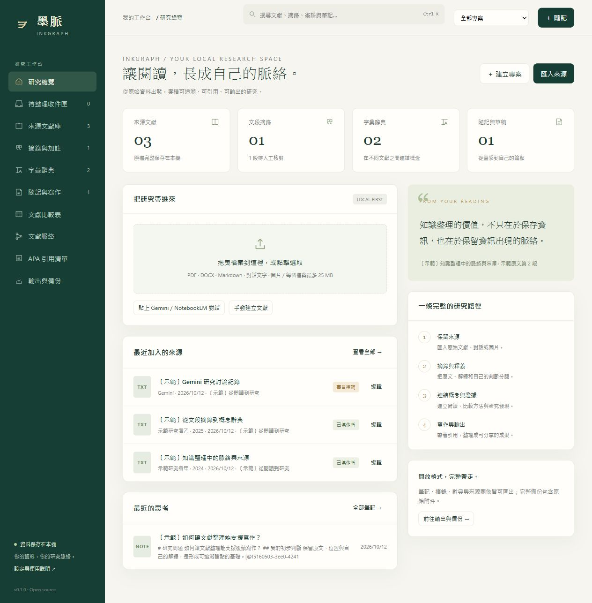

# 墨脈 InkGraph

**用 Chrome 開啟的本地研究知識工作台。** 把文獻、原文摘錄、釋義、概念辭典和自己的思考連起來。資料庫與原始附件保存在你的電腦；只有你明確送出的文字才會交給可選的 Gemini API。



第一版 `v0.1.0` 是可以實際使用的單人本地應用。適用於學術研究、專案整理與日常筆記。

## 快速開始

需要 **Node.js 24 或更新版本**。安裝 Node.js 後，在專案目錄執行：

```sh
npm install
npm start
```

在 Chrome 開啟 **http://127.0.0.1:4317**。Windows 也可雙擊 `start-inkgraph.cmd`；首次使用會嘗試安裝相依套件，之後可離線啟動。

使用 `Ctrl+C` 停止服務。若預設連接埠被占用，可使用環境變數 `PORT`。備份或移動資料前請先停止服務，或直接使用介面的完整 ZIP 備份。

```powershell
# Windows PowerShell: 使用另一個連接埠及獨立資料目錄
$env:PORT = '4318'
$env:INKGRAPH_DATA_DIR = 'D:\MyResearchVault'
npm start
```

```sh
# macOS / Linux
PORT=4318 INKGRAPH_DATA_DIR="$HOME/MyResearchVault" npm start
```

資料預設保存在 `data/inkgraph.sqlite`；原始附件儲存在 SQLite 的 BLOB 欄位。`data/` 已排除於 Git，不會隨原始碼上傳。

## 五項核心功能

| 功能 | 第一版行為 | 輸出 |
| --- | --- | --- |
| 文獻脈絡 | 專案、跨文獻比較表、支持／反駁／延伸／比較關係、理由與證據 | CSV、SVG、Markdown、JSON |
| 摘錄與釋義加註 | 原文、來源定位、釋義、自己的評論、人工核對狀態 | Markdown、HTML、列印 PDF |
| 字彙辭典 | 中文／外文名稱、定義、例句與原始來源；同一術語可有不同作者的定義 | CSV、Markdown、HTML |
| APA 引用 | CSL APA 7th 樣式、文內引用與書目、缺欄位提醒 | APA 文字、RIS、CSL-JSON |
| 隨記與寫作 | 收件匣、用途分類、Markdown 編輯、穩定來源 ID、手動儲存 | 單篇／專案 Markdown、HTML、列印 PDF |

一般輸出使用目前專案範圍。單筆資料可在閱讀／寫作工作區匯出。完整 ZIP 備份包含**全部專案、所有紀錄與原始附件**，不包含 API Key。

## 使用流程

1. 建立專案，或先把來源放進待整理收件匣。
2. 匯入 PDF、DOCX、TXT、Markdown、HTML、JSON、CSV 或 PNG/JPG/WebP。
3. 核對作者、年份、來源類型與 DOI。
4. 閱讀時選取原文，建立摘錄並填寫頁碼／段落位置。
5. 在釋義與加註欄寫下你的理解，再連到術語與文獻關係。
6. 在筆記中插入引用，輸出研究筆記與參考文獻。

首頁的「載入示範專案」會建立**清楚標記的合成示範資料**；示範作者、原文與文獻不可作為真實研究證據。

## 匯入 Gemini / NotebookLM

- 可貼上對話／筆記，或匯入下載的 TXT、Markdown、HTML、JSON、DOCX。
- HTML 永遠以純文字處理，原始檔案作為附件保存，不執行其中的 script。
- JSON 與 HTML 是通用文字匯入，**尚未實作專用 Takeout 對話重建**。
- 貼上的 Gemini／NotebookLM 對話預設為「AI 對話／筆記」，不列入 APA 清單；正式引用請配對並核對原始文獻。
- 匯入不等於雲端同步。第一版不會登入 Google、抓取帳號資料或自動同步。

官方匯出說明：[Gemini 資料下載](https://support.google.com/gemini/answer/16920332)、[NotebookLM 筆記匯出](https://support.google.com/notebooklm/answer/16262519)。Google 功能與匯出格式可能變動，請先確認實際匯出內容。

## 引用與書目

在写作工作區使用「插入引用」，或輸入：

```text
[@source-id]
[@source-id, p. 12]
[@source-id, p. 12–14]
```

輸出時會轉成 APA 文內引用，並在該篇筆記後加入引用來源清單。同作者同年份的 a/b 區分依該篇清單計算。尚未配對的引用標記會保留並提示來源遺失。

英文作者請填寫 `姓氏, 名字`，多位作者用半形分號分隔；完整中文姓名或機構名稱可直接填入。第一版使用通用 APA 7th 樣式，並非特定學校的中文格式。書目品質取決於人工核對的欄位；格式引擎不會補造文獻資料。

APA formatting powered by **citeproc-js © Frank Bennett**. Official APA CSL style and locale are bundled and pinned for offline operation; see `vendor/provenance.json` and `THIRD_PARTY_NOTICES.md`.

## 可選 Gemini AI

來源或筆記中的「AI 整理」會開啟傳送預覽。你可改寫或刪減文字，再填入 API Key 與你帳號可用的模型 ID。只有你按下「傳送上述內容」後才會連線到 Google。

API Key 只存在目前頁面記憶體，請求時傳给本機服務再轉給 Gemini；不寫入資料庫、localStorage、備份或日誌。AI 回應不會覆寫來源，可另存為「待人工核對」草稿。第一次部署的真實雲端連線需要自己的 Key；自動測試使用模擬回應，沒有呼叫付費服務。

## 備份與還原

完整 ZIP 內含 `manifest.json`、`attachments/<id>` 及閱讀用的 `research.md`。附件有 SHA-256 校驗。還原會先檢查完整性，再以 SQLite transaction 寫入；相同資料略過，有不同版本則停止，不覆寫目前資料。

要還原舊版資料，先停止服務，用 `INKGRAPH_DATA_DIR` 指定新的空目錄再匯入備份。ZIP 還原上限為 100 MB、解壓縮後 250 MB、最多 5,000 項。單一來源檔案上限為 25 MB；PDF 最多 1,000 頁。完整備份不包含可重用的 Gemini 憑證。

## 已知限制

- 圖片與掃描 PDF 支援預覽／手動摘錄，**尚未提供 OCR**。
- DOCX 擷取文字，不保留原版面頁碼。PDF 檔案頁序與印刷頁碼需分別核對。
- 原文高亮可帶入摘錄；重新定位目前透過頁碼／段落標記與原文閱讀，尚未提供點擊自動捲至高亮區域。
- 全文搜尋為字串包含比對，尚未提供向量搜尋、中文斷詞或大型資料庫最佳化。
- 筆記需手動儲存，有離開前提示；沒有自動草稿恢復、垃圾桶或刪除功能。
- Markdown 以文字編輯／匯出，尚未提供完整所見即所得或 Markdown HTML 渲染。
- HTML 報告可列印成 PDF；尚未提供 DOCX 報告、Word 動態引用欄位、BibTeX 匯出。
- 文獻比較欄位與關係圖由使用者填寫，不自動判定研究證據。
- 僅供同一電腦單人使用，不是可公開部署的多使用者雲端系統。

## 開發與驗證

```sh
npm run check
npm test
```

測試涵蓋儲存重啟、參照與版本衝突、APA 與同年消歧義、原始附件備份還原與竄改校驗、檔案解析、匯出資料、HTML／CSV 處理、本機 API 隔離及模擬 Gemini 請求。

介面採原生 HTML/CSS/JavaScript，服務使用 Node HTTP 與 SQLite，沒有建置步驟或 CDN。設計與資料模型見 [docs/DESIGN.md](docs/DESIGN.md)，後續規劃見 [docs/ROADMAP.md](docs/ROADMAP.md)。相依版本固定在 `package.json` 與 `pnpm-lock.yaml`；npm 使用者依 package.json 的固定直接相依版本安裝。

## 開源授權

墨脈 InkGraph 使用 **GNU AGPL v3 或更新版本**，詳見 [LICENSE](LICENSE)。引用引擎採其原始碼授權聲明允許的 AGPL v3+ 選項；第三方套件及 CSL 資產保留各自授權。研究資料與上傳附件不因程式碼的開源授權而自動公開。

Copyright © 2026 InkGraph contributors.
