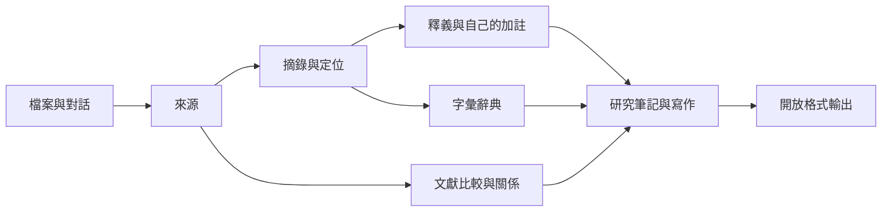

# 墨脈第一版設計

## 產品定位

Chrome 中的單人本地研究工作台，服務學術文獻回顧、專案研究及閱讀隨記。所有功能有資料輸出；使用者能保留來源並帶走完整研究紀錄。UI 是繁體中文，採深綠導覽、暖白閱讀紙面與低彩度標記，讓長時間閱讀比管理按鈕更突出。

三個主要工作區：收件匣、閱讀加註、研究寫作。其餘畫面是同一資料庫的不同視圖，不複製原始資料。

## 知識路徑

## 資料模型

SQLite `entities` 表保存穩定 ID、類型、JSON 內容、建立／更新時間及 revision。`attachments` 表保存附件 ID、來源外鍵、檔名、MIME、SHA-256 和原始 bytes。原始檔不可在介面中覆寫；文字解讀與書目資料獨立於附件。

| 類型 | 主要欄位 | 關聯 |
| --- | --- | --- |
| project | title, description, purpose | 所有資料可指派專案；未指定則在收件匣 |
| source | title, authors, year, cslType, origin, text, pages, summary, method, findings, limitations | 附件以 source_id 外鍵連結 |
| annotation | quote, locator, paraphrase, comment, verified, sourceRevision, sourceHash | sourceId 必填 |
| term | title, aliases, definition, example, tags | sourceId 可選，同詞可有多筆不同來源定義 |
| note | title, content, noteType, sourceIds, tags | 來源 ID 保留在文內引用標記及清單 |
| relation | from, to, relation, reason | 連結兩份不同來源；附證據理由 |

書目轉為 CSL 時依資料類型選擇欄位。AI 對話的 `personal-communication` 是應用內分類，不作為正式參考文獻輸出。

原文、AI 草稿與自己的釋義分開。摘錄保留人工核對狀態；系統不把文字相符自動視為已核對。

## 架構與邊界

- Node.js 24：原生 HTTP、SQLite、檔案解析與匯出。
- 原生 browser UI：無框架、無 build、無 CDN。
- PDF.js 文字擷取、Mammoth DOCX 文字擷取；不執行來源文檔中的 HTML/script。
- citeproc-js：APA 7th 格式；CSL 與英文 locale 固定版本保存在 vendor。
- JSZip：原始附件與結構紀錄備份；還原先驗證，再 transaction 寫入。
- 雲端 AI：本機服務代理 Gemini generateContent，API Key 不落盤，傳送內容先由使用者檢視。

服務僅監聽 127.0.0.1，驗證 Host、Origin，API 要求每次啟動生成的工作階段 token；附件要求 HttpOnly SameSite cookie。CSP 禁止來源內容中的 script。這些邊界不提供對惡意本機程式、共用 OS 帳戶、磁碟遭竊或瀏覽器擴充套件的保護；資料沒有磁碟加密。需要遠端使用時，必須另外設計身分驗證、授權與 HTTPS，不能直接開放此服務。

更新要求舊 revision，避免兩個頁籤靜默覆寫。一般 UI 不提供刪除；備份還原遇到版本不同會停止，使用者可改在新的資料目錄還原。

## 輸出契約

- Markdown/HTML：原文摘錄、定位、人工核對狀態、釋義、評論、詞條、筆記及 APA。
- CSV：文獻矩陣、字彙辭典；UTF-8 BOM、引號及試算表公式前綴處理。
- SVG：文獻關係圖；JSON 保留完整關係理由。
- RIS/CSL-JSON：書目交換。
- ZIP：可還原的原始附件與完整結構，不只可閱讀報告。

目前專案範圍作用於一般輸出；完整 ZIP 固定涵蓋全部專案。筆記可獨立輸出並攜帶其相關來源。每篇筆記的文內引用與書目以該篇範圍一起計算。

## 驗收案例

1. 新增來源並停止、重啟服務，資料仍存在。
2. 文段摘錄的來源、定位、釋義與核對狀態能匯出。
3. 同一術語可保留不同文獻定義。
4. APA 文內引用包含作者／年份／直接引用頁碼；同作者同年清單有 a/b。
5. 隨記可進收件匣、指派專案、插入來源並匯出。
6. 備份可還原到空 vault，原始附件 bytes 與 ID 保持一致。
7. 附件竄改、來源遺失或資料版本衝突時，還原不寫入部分資料。
8. 啟用 AI 前看到準備送出的文字；回應只另存草稿。

實際機器測試與人工瀏覽器檢查紀錄見 `docs/VALIDATION.md`。
